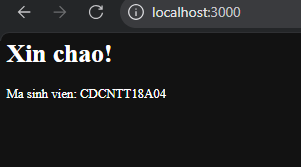

## 1. Cách chạy chương trình

Bước 1: Tạo thư mục bài tập

Mở Terminal hoặc PowerShell, di chuyển đến thư mục chứa bài tập và tạo thư mục Bt02:

mkdir Bt02
cd Bt02

Bước 2: Tạo tập tin bai02.js

Sử dụng lệnh:

notepad bai02.js

Viết mã nguồn tạo Web Server bằng module http, xử lý các đường dẫn /, /about và trả về trạng thái 404 đối với đường dẫn không tồn tại.

Bước 3: Chạy chương trình

Tại Terminal, thực hiện lệnh:

node bai02.js

Sau khi chạy thành công, Web Server hoạt động tại cổng 3000.

Bước 4: Kiểm tra trên trình duyệt

Mở trình duyệt và truy cập các địa chỉ sau:

Trang chủ:

http://localhost:3000

Kết quả: Hiển thị lời chào và mã sinh viên CDCNTT18A04.

Trang giới thiệu:

http://localhost:3000/about

Kết quả: Hiển thị thông tin giới thiệu bản thân.

Đường dẫn không tồn tại:

http://localhost:3000/abc

Kết quả: Server trả về mã trạng thái HTTP 404 và thông báo không tìm thấy trang.

## 2. Kết quả thực hiện

Trang chủ:

Hiển thị lời chào và mã sinh viên CDCNTT18A04.

Trang giới thiệu:

Hiển thị họ tên Võ Duy Anh, mã sinh viên và thông tin trường học.

Trang lỗi 404:

Khi truy cập đường dẫn không tồn tại, chương trình trả về mã trạng thái HTTP 404 và thông báo không tìm thấy trang.

## 3. Hình ảnh minh chứng

