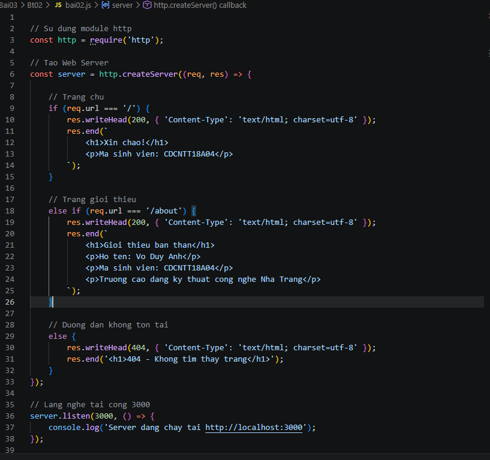
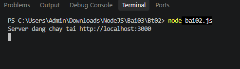
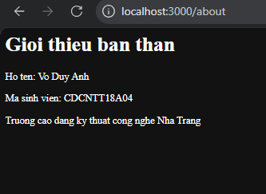
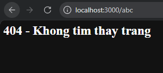

## 1. Cách chạy chương trình

Bước 1: Truy cập repository GitHub:

https://github.com/voduyanhgalaxys4-code/Bt02

Bước 2: Chọn Code → Download ZIP để tải mã nguồn về máy tính.

Bước 3: Giải nén tập tin ZIP vừa tải về.

Bước 4: Mở Visual Studio Code, chọn File → Open Folder và mở thư mục chứa tập tin bai02.js.

Bước 5: Chọn Terminal → New Terminal để mở Terminal.

Bước 6: Kiểm tra Node.js đã được cài đặt:

node -v

Bước 7: Chạy chương trình bằng lệnh:

node bai02.js

Bước 8: Khi Terminal hiển thị thông báo server đang chạy, mở trình duyệt và truy cập các địa chỉ:

Trang chủ: http://localhost:3000/

Trang giới thiệu: http://localhost:3000/about

Trang không tồn tại: http://localhost:3000/abc

Lưu ý: Cần cài đặt Node.js trước khi thực hiện. Không cần cài đặt thêm thư viện bên ngoài.

## 2. Kết quả thực hiện

Trang chủ:

Hiển thị lời chào và mã sinh viên CDCNTT18A04.

Trang giới thiệu:

Hiển thị họ tên Võ Duy Anh, mã sinh viên và thông tin trường học.

Trang lỗi 404:

Khi truy cập đường dẫn không tồn tại, chương trình trả về mã trạng thái HTTP 404 và thông báo không tìm thấy trang.

## 3. Hình ảnh minh chứng

